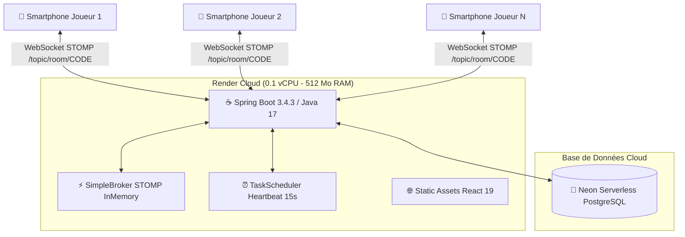

# 🏛️ Architecture Technique du Projet Loustic

Loustic repose sur une architecture moderne découplée, optimisée pour offrir une expérience multijoueur en temps réel fluide même sur des infrastructures contraintes (comme le palier gratuit de Render).

---

## 🏗️ 1. Vue d'Ensemble de la Stack



---

## ⚡ 2. Optimisations Mémoire et CPU pour Render (512 Mo de RAM)

Pour éviter les crashs `OOMKilled` et les gels de Garbage Collection sur le conteneur gratuit de Render :
```bash
JAVA_TOOL_OPTIONS: "-XX:MaxRAMPercentage=75.0 -XX:+UseSerialGC -Xss512k -XX:CICompilerCount=2"
```

1. **`MaxRAMPercentage=75.0`** : Limite l'allocation du tas Java (Heap) à ~380 Mo. Les ~130 Mo restants sont préservés pour la mémoire native, le noyau Linux et les bibliothèques C (glibc).
2. **`+UseSerialGC`** : Désactive le garbage collector multi-thread G1 au profit du ramasse-miettes séquentiel. Sur 0.1 vCPU partagé, le SerialGC élimine les gels de threads et préserve le processeur.
3. **`-Xss512k`** : Réduit de 1024k à 512k la taille de pile allouée à chaque thread. Cette division par deux permet d'accueillir des dizaines de connexions WebSocket sans saturer la RAM.
4. **`-XX:CICompilerCount=2`** : Limite le nombre de threads du compilateur JIT pour réduire l'empreinte mémoire à froid.

---

## 📡 3. Modèle de Synchronisation WebSocket STOMP

Loustic n'utilise pas de polling HTTP coûteux. Toute action de jeu suit ce flux unidirectionnel rapide :

1. **Envoi par un client** :
   Le joueur envoie une trame STOMP sur `/app/room/{code}/{action}` contenant son identifiant et sa charge utile.
2. **Traitement par le contrôleur** :
   [`GameWebSocketController.java`](file:///Users/baffourlouis/Desktop/jouonsAvecLouis%20copie/loustic-backend/src/main/java/com/loustic/controller/GameWebSocketController.java) intercepte l'action, vérifie la validité de la session et invoque le service métier dédié.
3. **Mise à jour d'état atomique** :
   Le service dédié modifie l'état de la salle stocké en mémoire dans un `ConcurrentHashMap` protégé.
4. **Diffusion instantanée** :
   Le serveur publie un événement [`RoomEvent`](file:///Users/baffourlouis/Desktop/jouonsAvecLouis%20copie/loustic-backend/src/main/java/com/loustic/model/RoomEvent.java) sur le canal `/topic/room/{code}`. Tous les téléphones connectés mettent à jour leur interface en moins de 50 millisecondes.

---

## 🛡️ 4. Stratégie Anti-Triche et Sécurité

Afin d'empêcher qu'un joueur malicieux n'ouvre l'inspecteur réseau de son navigateur mobile pour lire les réponses secrètes :
- Les mots secrets (*Motus*, *La Taupe*, *Spy*) ne sont **jamais** envoyés en clair dans les trames publiques pendant une manche en cours.
- L'état diffusé aux joueurs utilise des DTOs masqués (`maskedWord`, statuts partiels).
- Les cartes blanches soumises dans *Limite Prison* sont préalablement mélangées (shuffle) côté serveur avant publication pour masquer l'auteur de chaque carte.
