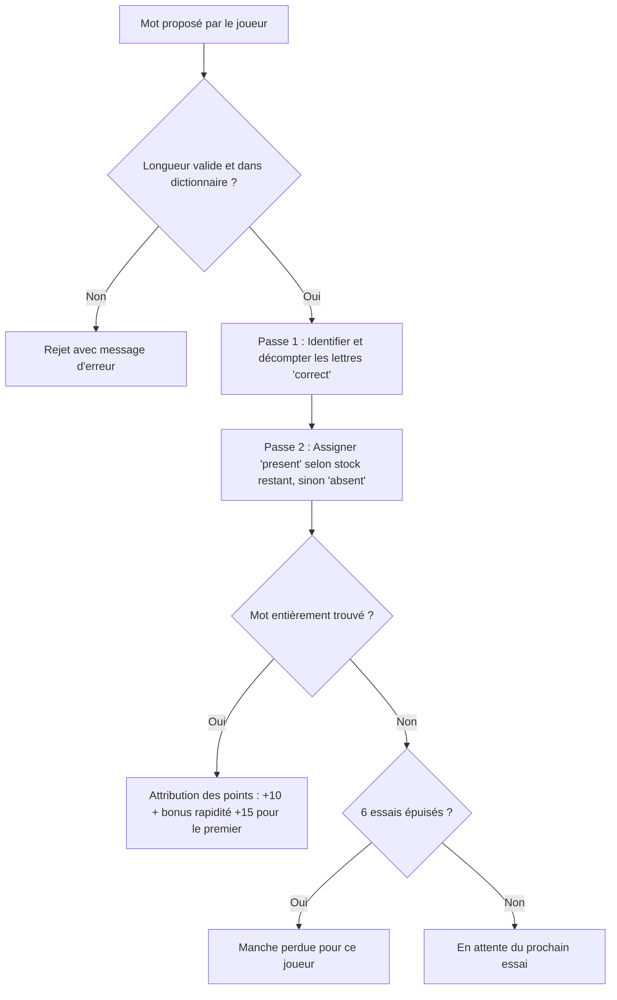

# 🧠 Logique et Algorithmes des Jeux Complexes de Loustic

Ce document détaille les règles métier, les machines à états et les algorithmes mis en œuvre dans les jeux les plus complexes de la plateforme **Loustic**.

---

## 🟥 1. Motus (Tusmo / Lingo)

*Classe métier associée :* [`MotusGameService.java`](file:///Users/baffourlouis/Desktop/jouonsAvecLouis%20copie/loustic-backend/src/main/java/com/loustic/service/MotusGameService.java)

### A. Principe du jeu
Les joueurs doivent deviner un mot secret en français (de 6 à 8 lettres) en 6 essais maximum. Chaque lettre est colorée pour indiquer si elle est :
- **Bien placée** (`correct` / Rouge 🟥)
- **Mal placée** (`present` / Jaune 🟨)
- **Absente du mot** (`absent` / Bleu ou Gris ⬛)

### B. Algorithme d'évaluation en 2 passes
Un écueil classique dans l'évaluation de mots réside dans la gestion des lettres dupliquées (ex: deviner `BALLON` avec `BANANE`). Pour éviter d'afficher des lettres jaunes en surnombre, l'algorithme procède rigoureusement en **deux passes** :

```
Passe 1 : Recherche des lettres bien placées (Vert/Rouge)
  Pour chaque position i :
    Si guess[i] == target[i] :
      evaluation[i] = "correct"
      letterCount[target[i]]--

Passe 2 : Recherche des lettres mal placées (Jaune)
  Pour chaque position i :
    Si evaluation[i] n'est pas encore "correct" :
      Si letterCount[guess[i]] > 0 :
        evaluation[i] = "present"
        letterCount[guess[i]]--
      Sinon :
        evaluation[i] = "absent"
```



### C. Sécurité et Anti-Triche
Le mot secret n'est envoyé aux clients que sous forme masquée (`maskedWord`, ex : `B*****`) tant que la manche n'est pas résolue ou abandonnée par tous les joueurs.

---

## 📊 2. Classe Moi Ça

*Classe métier associée :* [`ClasseMoiCaGameService.java`](file:///Users/baffourlouis/Desktop/jouonsAvecLouis%20copie/loustic-backend/src/main/java/com/loustic/service/ClasseMoiCaGameService.java)

### A. Principe du jeu
Jeu coopératif où les joueurs reçoivent un chiffre secret entre **1 et 100** pour une thématique donnée (ex : *"Intensité de douleur d'une piqûre d'insecte"* ou *"Probabilité de survie dans un film d'horreur"*).
- Chaque joueur doit exprimer son chiffre sous la forme d'un exemple oral ou écrit sans jamais prononcer le chiffre lui-même.
- Les joueurs doivent ordonner collectivement leurs propositions de la plus faible à la plus forte.

### B. Machine à états et décompte des erreurs
1. **Attribution des chiffres** : Le serveur génère des nombres distincts $N_i \in [1, 100]$ par joueur à l'aide de `SecureRandom`.
2. **Phase de classement** : L'interface permet de déplacer et réorganiser les propositions.
3. **Révélation et calcul des inversions** :
   Le serveur compare l'ordre soumis $O = (c_1, c_2, \dots, c_k)$ avec l'ordre réel trié croissant. Pour toute paire $(i, j)$ avec $i < j$ telle que $val(c_i) > val(c_j)$, une faute est comptabilisée :
   $$\text{Erreurs} = \sum_{1 \le i < j \le k} \mathbb{I}(val(c_i) > val(c_j))$$
4. **Vies d'équipe** : L'équipe démarre avec un capital de vies. Chaque inversion consomme 1 vie. Si 0 inversion est commise, une manche parfaite est validée.

---

## ⛓️ 3. Limite Prison (Inspiré de Blanc Manger Coco)

*Classe métier associée :* [`LimitePrisonGameService.java`](file:///Users/baffourlouis/Desktop/jouonsAvecLouis%20copie/loustic-backend/src/main/java/com/loustic/service/LimitePrisonGameService.java)

### A. Rôles et flux de jeu
- À chaque manche, un joueur est désigné **Juge / Gardien**, tandis que les autres sont les **Détenus**.
- Une **carte noire** (phrase à compléter avec une case vide `___`) est piochée.
- Chaque détenu possède une main de 6 cartes blanches et choisit secrètement celle qui produit l'effet humoristique le plus percutant.

### B. Confidentialité des soumissions
Pour garantir l'impartialité absolue du juge :
1. Les soumissions sont stockées en mémoire avec `playerId`.
2. Dès que tous les détenus ont validé, le serveur applique un algorithme de mélange aléatoire (Fisher-Yates) sur la liste des cartes.
3. Les cartes sont envoyées au juge sans référence à l'identité des joueurs (`anonymousCards`).
4. Le juge sélectionne sa carte préférée. Le serveur retrouve le propriétaire légitime et lui attribue +1 point de respect.
5. Le rôle de juge pivote au joueur suivant.

---

## 🧠 4. Synapse (Inspiré de Tu Te Mets Combien - TTMC)

*Classe métier associée :* [`SynapseGameService.java`](file:///Users/baffourlouis/Desktop/jouonsAvecLouis%20copie/loustic-backend/src/main/java/com/loustic/service/SynapseGameService.java)

### A. Mécanique de pari de compétence
Sur un thème tiré au sort parmi 190 catégories (ex : *"Les capitales méconnues"*, *"Les répliques de cinéma"*, *"Les plats italiens"*), le joueur actif doit s'auto-évaluer sur une échelle de **1 à 10** :
- **Niveaux 1 à 5** : Questions accessibles, grand public ou de bon sens.
- **Niveaux 6 à 10** : Questions d'érudition, expertes, pièges ou insolites.

### B. Arbre de décision et récompense
$$\text{Points gagnés} = 
\begin{cases} 
\text{Niveau choisi} & \text{si réponse correcte} \\
0 & \text{si réponse incorrecte}
\end{cases}$$

Ce système incite à mesurer le risque : tenter un niveau 8 rapporte 8 points, mais expose à un échec cuisant si la réponse est erronée.

---

## 💣 5. Bomb Party

*Classe métier associée :* [`BombGameService.java`](file:///Users/baffourlouis/Desktop/jouonsAvecLouis%20copie/loustic-backend/src/main/java/com/loustic/service/BombGameService.java)

### A. Algorithme du timer dynamique
Une bombe virtuelle est transmise de joueur en joueur :
1. Une syllabe imposée est tirée (ex : *"TER"*, *"GRA"*, *"CHA"*).
2. Le joueur actif dispose de la bombe et doit énoncer un mot français valide contenant la syllabe.
3. La durée de la mèche est calculée par une loi uniforme aléatoire :
   $$T_{\text{explosion}} = T_{\text{actuel}} + \text{Random}(12\text{s}, 28\text{s})$$
4. Dès qu'un mot est validé, la bombe passe immédiatement au joueur suivant et la syllabe est renouvelée.
5. Lorsque le timer expire, le joueur tenant la bombe perd une vie et reçoit un gage humoristique.

---

## 🕵️ 6. La Taupe & SPY

*Classes associées :* [`LaTaupeGameService.java`](file:///Users/baffourlouis/Desktop/jouonsAvecLouis%20copie/loustic-backend/src/main/java/com/loustic/service/LaTaupeGameService.java), [`SpyGameService.java`](file:///Users/baffourlouis/Desktop/jouonsAvecLouis%20copie/loustic-backend/src/main/java/com/loustic/service/SpyGameService.java)

### A. Dissymétrie d'information
- **SPY** : Tous les joueurs innocents reçoivent le lieu de la mission (ex: *"Sous-marin nucléaire"*). L'espion ne reçoit rien (`???`). Chacun donne un indice en un mot sans révéler directement le lieu pour ne pas aider l'espion.
- **La Taupe** : Tous les innocents reçoivent le mot A (ex : *"Tour Eiffel"*), la Taupe reçoit un mot B très voisin (ex : *"Statue de la Liberté"*). Les joueurs débattent et tentent de démasquer l'infiltré lors du vote final.
